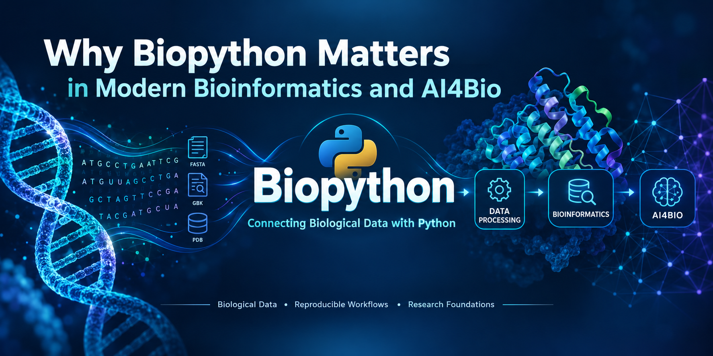

# Why Biopython Matters in Modern Bioinformatics and AI4Bio

*An overview — the substance and sources live in the documentation below.*

Biopython is a set of freely available Python tools for biological computation, developed since 1999 by an international contributor community.[1] This repository reviews what Biopython provides, its limits, and how it fits into computational biology and AI-for-bio workflows. Bracketed numbers refer to the source register in [7. References](docs/07-references.md).

## The short version

Biopython is a domain-specific Python **library** for biological data — sequences and annotations, common file formats, database retrieval, structures, phylogenetics, and related tasks.[4][5] In an AI4Bio workflow it can help **upstream**: retrieving, parsing, representing, and preparing biological data before modeling. It is **not an AI model** and does not train or run machine learning. Whether it fits a project depends on the data, the workflow, and the alternatives.

## Documentation

| Document | What it covers |
|---|---|
| [1. What Is Biopython?](docs/01-what-is-biopython.md) | Definition, provenance, module map, licensing, citation |
| [2. Problems Biopython Solves](docs/02-problems-biopython-solves.md) | Capability inventory with format caveats and dependency classes |
| [3. Biopython vs. Plain Python](docs/03-biopython-vs-plain-python.md) | Trade-offs between the library and hand-written code |
| [4. Biopython in Modern Bioinformatics](docs/04-biopython-in-modern-bioinformatics.md) | Workflow role, interoperability, reproducibility (supported, not guaranteed) |
| [5. Biopython in AI4Bio](docs/05-biopython-in-ai4bio.md) | Pipeline fit — and where NumPy, pandas, PyTorch, and AlphaFold take over |
| [6. Limitations and Alternatives](docs/06-limitations-and-alternatives.md) | Boundaries, dependencies, alternatives, decision guidance |
| [7. References](docs/07-references.md) | Annotated, verified source register |

## Capabilities at a glance

- Sequence and annotation objects, and input/output for common biological formats ([details](docs/02-problems-biopython-solves.md))
- Alignment, database retrieval, BLAST, structures, phylogenetics — each with documented dependency requirements ([details](docs/02-problems-biopython-solves.md))
- Interoperability with the Python scientific stack ([details](docs/04-biopython-in-modern-bioinformatics.md))

## Limitations at a glance

- Not a substitute for domain knowledge or biological validation ([details](docs/06-limitations-and-alternatives.md))
- Some features require external software or network services ([details](docs/06-limitations-and-alternatives.md))
- Specialized tasks — large-scale genomics, microbiome statistics, model training — have specialized tools ([details](docs/06-limitations-and-alternatives.md))

## About "AI4Bio"

This repository uses "AI4Bio" as an informal umbrella term for AI — especially machine learning and deep learning — applied to biological research problems. It is not a formally standardized designation; the term survey and its limitations are in [document 5](docs/05-biopython-in-ai4bio.md) and [7. References](docs/07-references.md).

## Citing Biopython

If you use Biopython in scientific work, the project asks that you cite the 2009 application note: Cock et al., "Biopython: freely available Python tools for computational molecular biology and bioinformatics," *Bioinformatics* 25(11):1422–1423, 2009, DOI [10.1093/bioinformatics/btp163](https://doi.org/10.1093/bioinformatics/btp163) — and/or one of the module-specific publications the project lists.[2][10]

All sources used by this repository, with verification status and claim mapping, are in [7. References](docs/07-references.md).

## License and attribution

© 2026 kelvinchandradjayapranata-hue. The documentation text and images created for this repository are licensed under the [Creative Commons Attribution 4.0 International License](https://creativecommons.org/licenses/by/4.0/) (CC BY 4.0), applied by the copyright holder **to the extent of the rights held**. *This work is licensed under the Creative Commons Attribution 4.0 International License. To view a copy of this license, visit https://creativecommons.org/licenses/by/4.0/* — attribution: `kelvinchandradjayapranata-hue`, 2026. The full legal code is in [LICENSE](LICENSE).

Scope and transparency notes:

- **Applied by the owner, not issued by a third party.** The CC BY 4.0 designation is this repository's copyright holder's licensing choice for the rights they hold; it is not a license granted by OpenAI or any other tool provider, and it makes no claim about the copyright status of AI-generated output.
- **Third-party material is not covered.** Quotations and material from the sources listed in [7. References](docs/07-references.md) — text from third-party sites, facts, module and project names — remain under the rights and attribution of their respective owners.
- **No trademark or logo rights are granted.** CC BY 4.0 licenses copyright and similar rights only (legal code §2(b)(2)); trademark rights are unaffected. Names and logos referenced in this repository — including the Python logo, a trademark of the Python Software Foundation — belong to their respective owners.
- **AI-generated hero image.** The infographic above is an AI-generated illustration; its embedded Content Credentials metadata records the generating tool as ChatGPT/gpt-image. That metadata has been inspected but **not cryptographically validated**. Stylized marks in the illustration that resemble project logos are not official logos, and no affiliation with or endorsement by any project or organization is claimed.
